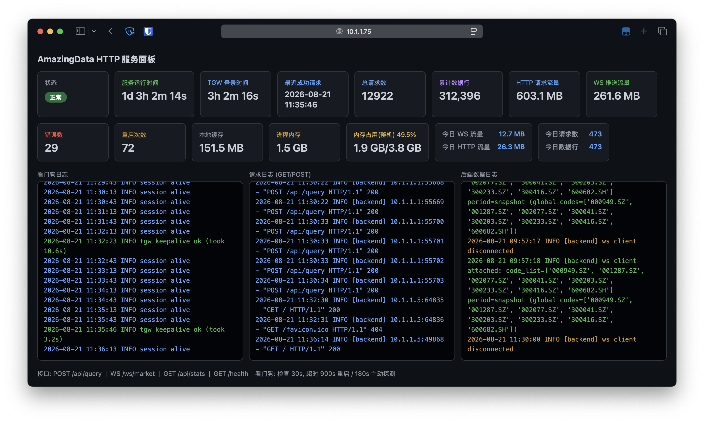

# AmazingData HTTP 网关



因为银河证券星耀智数 SDK 只能运行在 x86 架构的机器上，我的策略是运行在arm架构的 Mac mini上 的，没法直接用，还有很多奇奇怪怪的问题比如登录限制，内存溢出等问题，就用 AI 做了个转发的中间层，以提高其兼容性。  
**本项目是在一台x86架构，内存为4GB的 Debian Linux 平台构建和运行的，我用了一段时间已经稳定运行，大部分主要功能都经过测试没有问题，因为是用 AI 搓的，在我这里用可能没问题可能换个环境就有问题，到时候自行让 AI 来帮你解决，解决不了就让 AI 帮你重写整个项目也行，这里只是提供一个思路而已**

把 **AmazingData** 封装成一个 HTTP 中间层 + 内置状态面板，对外提供 REST 查询、WebSocket 实时行情推送，并自带看门狗自愈与  
`/health` 健康检查接口。

> 本目录是**已脱敏、可独立开源**的版本：所有个人账号、密码、私有 IP、本地路径均已移除，  
> 改为由 `config.ini` 配置。请勿把填好真实凭据的 `config.ini` 提交到公开仓库。

---

## 1. 目录结构

```
amazingdata-http-gateway/
├── http_service.py      # 主程序(FastAPI): REST/WS/看门狗/UI
├── index.html           # 内置状态面板(随 http_service.py 一起提供服务)
├── config.example.ini   # 配置模板(复制为 config.ini 后填写)
├── run.sh               # 启动 + 存活检测脚本(配合 crontab 守护)
├── requirements.txt     # pip 依赖
├── HTTP_API_SPEC.md     # 完整接口文档
├── .gitignore           # 忽略 config.ini / 本地数据 / 日志
└── README.md
```

---

## 2. 依赖安装

```bash
pip install -r requirements.txt
```

`AmazingData` SDK 为数据服务商提供的私有 Python 包，不通过 pip 公开分发，  
请按服务商指引单独安装（安装后 `import AmazingData` 可用即可）。

---

## 3. 配置

复制模板并填写你自己的数据源账号与服务器地址：

```bash
cp config.example.ini config.ini
vim config.ini
```

```ini
[tgw]
user     = <你的TGW账号>           # 数据源登录账号
password = <你的TGW密码>           # 数据源登录密码
host     = <数据源服务器IP或域名>   # 即"数据库"入口, 跑数据服务的机器
port     = 8600

[server]
host     = 0.0.0.0                # HTTP 监听地址(本机填 127.0.0.1 仅本机访问)
port     = 8000                   # HTTP 监听端口

[paths]
local_data = local_data          # 行情/数据本地缓存目录
```

配置优先级：**环境变量 > config.ini > 默认值**  
（环境变量名：`TGW_USER` `TGW_PASSWORD` `TGW_HOST` `TGW_PORT` `HTTP_HOST` `HTTP_PORT` `AMAZINGDATA_CONFIG`）。  
为避开系统自带的 `USER`/`HOST`/`PORT` 等环境变量，这里统一加了 `TGW_`/`HTTP_` 前缀。

---

## 4. 启动

### 方式 A：直接运行（调试/前台）

```bash
python3 http_service.py
# 或
python3 -m uvicorn http_service:app --host 0.0.0.0 --port 8000
```

打开浏览器访问 `http://<机器IP>:8000/` 即可看到状态面板。

### 方式 B：run.sh + crontab（推荐，生产守护）

`run.sh` 一个脚本同时完成**启动**和**存活检测**：它探测 `/health`，  
若进程不存在或无响应就自动拉起，因此配合 crontab 每分钟调用即可实现进程守护。

```bash
chmod +x run.sh

# 手动启动 / 查看状态 / 停止 / 重启
./run.sh           # 检测存活, 未运行则启动
./run.sh status
./run.sh stop
./run.sh restart
```

加入 crontab（每分钟执行一次存活检测 + 自拉起）：

```bash
# 把下面一行追加进当前用户的 crontab(请改成你的实际绝对路径)
(crontab -l 2>/dev/null; echo "* * * * * /绝对路径/amazingdata-http-gateway/run.sh >> /绝对路径/amazingdata-http-gateway/run/cron.log 2>&1") | crontab -

# 查看
crontab -l
```


> crontab 环境 PATH 较精简，若 `python3` 不在默认 PATH，可在调用前设置  
> `PYTHON_BIN=/path/to/python3`，例如：  
> `* * * * * PYTHON_BIN=/opt/venv/bin/python3 /绝对路径/.../run.sh ...`

日志与 PID 文件位于 `run/`：`run/server.log`（服务输出）、  
`run/http_service.pid`、`run/cron.log`（crontab 调用记录）。

---

## 5. 接口一览

| 接口           | 方法   | 说明                                      |
| ------------ | ---- | --------------------------------------- |
| `/`          | GET  | 内置状态面板(HTML)                            |
| `/api/query` | POST | 通用查询 `body={"cls","method","params"}`   |
| `/ws/market` | WS   | 实时行情推送(首帧 `code_list`, 支持动态增删订阅)        |
| `/api/stats` | GET  | 运行指标(JSON, 供 UI 拉取)                     |
| `/health`    | GET  | 健康检查, 返回 `{"status":"ok","login":true}` |

完整请求/响应格式见 [HTTP\_API\_SPEC.md](./HTTP_API_SPEC.md)。

健康检查示例：

```bash
curl http://127.0.0.1:8000/health
# {"status":"ok","login":true,"tgw_login_seconds":1234}
```

---

## 6. 与 AmazingData 主程序的关系

本网关是**独立的中间层**，只依赖 AmazingData 的 Python SDK（`import AmazingData`），  
不需要 AmazingData 桌面/客户端主程序一起部署。它可以单独放在任意一台能访问数据源  
服务器、且装有 SDK 的机器上运行。因此本目录与"主程序"解耦，适合单独开源。

---

## 7. 安全须知（脱敏说明）

- `config.ini` 含凭据，已被 `.gitignore` 忽略——**只提交 `config.example.ini`**。
- 部署机登录用的 `*.exp` / `server_auth` 等运维脚本属于私有资产，未纳入本目录。
- 生产环境建议将 `server.host` 设为 `127.0.0.1` 并在前面加一层反向代理/Nginx 做鉴权，  
  不要将 8000 端口直接暴露公网。
